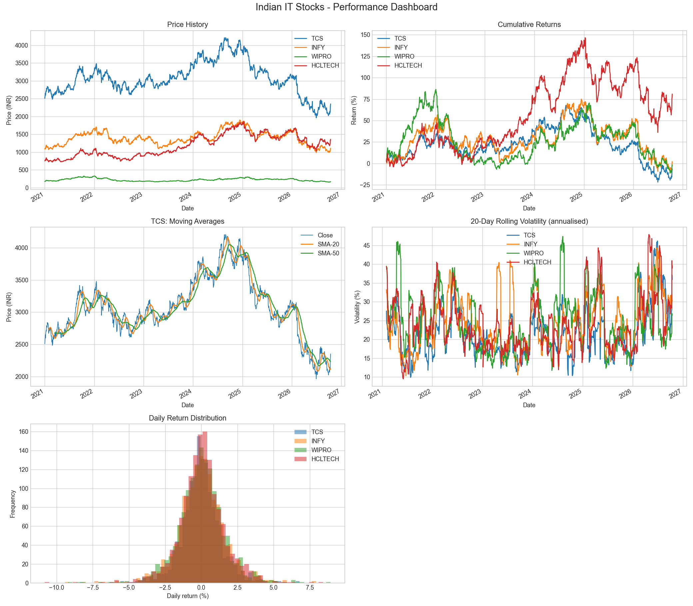

# 📈 Stock Market Performance Analyzer

An end-to-end Python analytics pipeline that compares four major Indian IT stocks — **TCS, Infosys (INFY), Wipro and HCLTech** — and extends the analysis into predictive modeling with a next-day price-direction classifier.



## What it does

| Stage | Details |
|-------|---------|
| **Data** | Downloads daily prices with `yfinance` and caches them in `data/stock_data.csv` |
| **Analytics** | Daily returns, cumulative returns, SMA-20 / SMA-50 moving averages, 20-day rolling annualised volatility |
| **Visualisation** | 5 chart types: price history, cumulative returns, moving averages, volatility, return distribution |
| **Machine learning** | Logistic Regression and Random Forest (scikit-learn) predict whether the next day's close will be higher or lower, using engineered technical indicators |

## Key findings

> Replace these with the numbers printed when you run the script.

- **Best performer:** HCLTECH (+__%)
- **Most volatile:** WIPRO (__% annualised)
- Next-day direction model accuracy: __% vs. a __% majority-class baseline

## ML approach

- **Features:** 1-day return, 5-day return, SMA-20/SMA-50 ratio, price vs SMA-20, 20-day volatility, RSI-14
- **Target:** `1` if tomorrow's close > today's close, else `0`
- **Validation:** chronological 80/20 train/test split (no shuffling), so the model never trains on the future
- **Reality check:** daily stock direction is very noisy. Results are compared to a naive baseline and are meant to demonstrate the ML workflow, **not** to give trading advice.

## Project structure

```
stock-market-analyzer/
├── README.md
├── stock_market_analyzer.py   # full pipeline
├── requirements.txt
├── data/
│   └── stock_data.csv         # generated on first run
└── screenshots/
    └── output.png             # dashboard of all charts
```

## How to run

```bash
git clone https://github.com/<your-username>/stock-market-analyzer.git
cd stock-market-analyzer
pip install -r requirements.txt
python stock_market_analyzer.py
```

The first run downloads the data and saves it to `data/stock_data.csv`; later runs reuse that file. Charts are written to `screenshots/`.

## Tech stack

Python · Pandas · NumPy · Matplotlib · scikit-learn · yfinance

## Author

**Yash R Kudalkar** — MCA, Karnatak University, Dharwad
📧 yashkudalkar107@gmail.com
